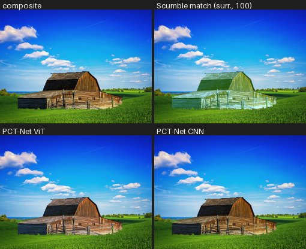
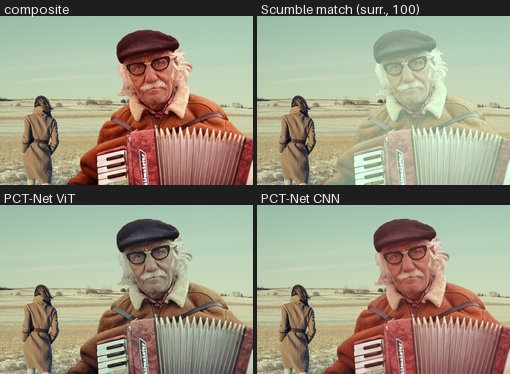
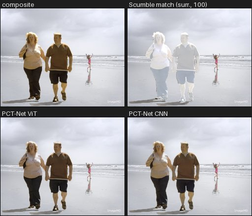
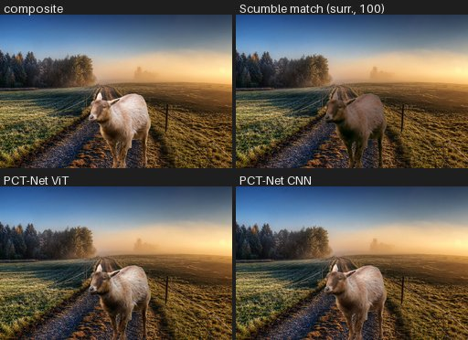
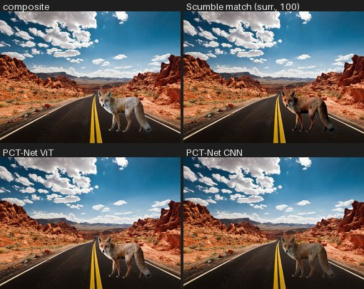
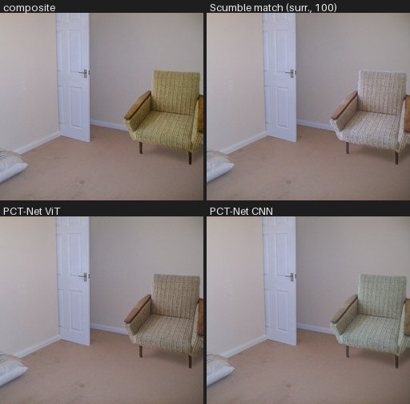

# Item 64: PCT-Net harmonization against Scumble's colour match (2026-11-16)

**Verdict: not clearly better.** PCT-Net (ViT) beats Scumble's *surroundings* match on pasted objects (the 99 real
composites), but it loses by a wide margin on the case Scumble is built for, an inpaint result over its own picture,
where the stitch's match and the *underneath* source can use the correspondence the model's crop gives them. It does
not replace the match. At most it could be an optional extra mode for pasted cut-outs and references, which is a
smaller gain than the item hoped for (section 6).

Everything ran locally in a session scratchpad. Nothing in the app was changed. The images below come from
iHarmony4's 99 real composites, which keep their sources' terms. They were used for a local evaluation only, and the
six thumbnails here are downscaled to 512 px or less.

## 1. What was run

| Step | Result |
|---|---|
| ONNX export, static 1x4x256x256, opset 17, MHA fast path off, einops replaced by reshape/permute (checked equal to einops) | `pctnet_vit.onnx` 19,409,877 B (sha256 `159a3673...4145`), `pctnet_cnn.onnx` 8,762,408 B (sha256 `15ecb99f...b893`, two outputs: params and attention) |
| ONNX against PyTorch, 4 random inputs each | max abs diff ViT 6.6e-7, CNN 4.4e-6 (params), 3.2e-6 (attention) |
| onnxruntime CPU 1.32.0, DirectML 1.24.4 (`onnxruntime-directml`, separate venv) | both run; DML against CPU max diff 7.7e-7 (ViT), 1.1e-5 (CNN) |
| Own full-res apply (net at 256, 12-channel map **bilinear** up, `out = clamp(M x + b)` per pixel, mixed with the mask) against the repo's own forward (bicubic) | with bicubic the same within 0.5 levels (rounding). Bilinear against bicubic inside the mask: mean 0.3-1.5 levels, max 5-17 levels, at the map's steep places |
| Scumble's match ported exactly | `inpaint_ed_match.js` `matchStats` / `statsOfMatch` (256 px statistics, 8 % pad, blurred alpha ring, alpha > 127, ratio clamped 0.5..2) + `kernels_js.js` `matchPixels`, sources surroundings and underneath, strength 100 (and 35 in a second pass). Also the stitch's `colorMatchRgba` (weighted by 1 - blend mask over the crop) |

Inputs are prepared as the repo's `evaluate_folder.py` does (resize to 256 x 256 with a plain linear filter, aspect
stretched). The ViT is mixed with the mask (`use_attn: False`, as it was trained). The CNN is mixed with its own
attention map (`use_attn: True`, as trained), upsampled and multiplied by the mask. Its attention averages 0.5 inside
the mask, so the CNN applies about half of its transform.

The UI's default match strength is **0** (off), so "Scumble at the default" is the unchanged composite.

## 2. The 99 real composites (no ground truth): judged by eye

I judged them blind: for each case the three outputs were shuffled into columns 1-3 next to the composite (seed 64),
ranked by eye on pages of six at about 250 px per panel, and decoded afterwards (`judge.txt`, `blind_key.json`). One
judge (Claude) did all the ranking.

**Pass 1: Scumble surroundings at strength 100 against PCT-Net (all 99)**

| vs Scumble surroundings 100 | better | same | worse |
|---|---|---|---|
| PCT-Net ViT | 73 | 11 | 15 |
| PCT-Net CNN | 75 | 6 | 18 |

Ranked first (ties count for each): Scumble 22, ViT 66, CNN 72.

**Pass 2 (fairer to Scumble): every third case (33), with the unchanged composite, Scumble surroundings at strength
35, and ViT shuffled together.** This pass was not truly blind, because I had already seen these outputs in pass 1.

| | better | same | worse |
|---|---|---|---|
| ViT vs Scumble 35 | 18 | 8 | 7 |
| ViT vs unchanged composite | 14 | 15 | 4 |
| Scumble 35 vs unchanged composite | 10 | 15 | 8 |

Ranked first: composite 15, Scumble 35 15, ViT 25.

The *underneath* source cannot be used on real composites. The picture under a pasted object is the object itself, so
the match is a no-op: mean change 0.3 levels, identical bytes on 72 of the 99. It appears only in section 3.

**Failure modes seen**

- *Scumble surroundings at 100*: strong colour casts from the ring's colours, because the object takes on the
  surroundings' mean and spread (green barn on grass, blue land under a blue sky, a green face on a green floor). It
  also produces washed-out, ghost-like objects, where a bright object on a pale background or a dark object on a
  light one is pulled to the backdrop's statistics: the pale couple on the beach, the white curlew, the translucent
  dog. The stretch ratio hit the 0.5 / 2 clamp on 41 of the 99. Median change inside the mask: 52 levels.
- *PCT-Net ViT / CNN*: mostly too timid (median change 18 / 17 levels) and sometimes a mild greying of a coloured
  object (CNN: the fox, a neutral chair turned grey-green). There were no strong casts. The 1:1 edge crops showed no
  haloes and no blotches from the upsampled map. The band just inside the mask edge changes 0.93x (ViT) and 0.84x
  (CNN) as much as the core does, so there is no rim. PCT-Net does not relight: a front-lit object in a backlit scene
  stays front-lit.

| | |
|---|---|
|  12: Scumble's surroundings cast (green barn) |  34: ViT takes the teal grade, Scumble washes out |
|  99: Scumble's ghost failure; PCT nearly no-op |  44: Scumble's darker goat fits the backlight better |
|  42: CNN greys the fox |  87: Scumble's neutral chair fits; CNN greys it |

## 3. An inpaint-shaped set with ground truth

A real inpaint result is a re-rendered crop whose colours drift, laid over its own picture. To imitate that, each
composite's object mask was moved onto genuine background, away from the pasted object, and feathered (2 px). The
whole crop, the mask's box plus a quarter on each side, was then drifted. Three kinds of drift were used, 31 cases
each:

- global: gain and offset per channel;
- tone: saturation, gamma, and a tint that fades into the highlights;
- spatial: a warm-to-cool and exposure ramp across the crop.

The picture itself is the truth, and the score is the MSE inside the mask (0..255 scale).

| mean MSE (median) | none | S surroundings | S underneath | stitch match | ViT | CNN |
|---|---|---|---|---|---|---|
| global (31) | 342 (228) | 280 (162) | **3.6** (0.6) | 4.5 (0.7) | 127 (63) | 207 (168) |
| tone (31) | 254 (199) | 283 (128) | **17.9** (13) | 23.4 (15) | 93 (64) | 227 (115) |
| spatial (31) | 81 (67) | 291 (162) | **53** (43) | 77 (61) | 176 (123) | 279 (191) |
| all (93) | 226 (151) | 284 (153) | **24.9** (13) | 35.1 (18) | 132 (77) | 238 (165) |

ViT beat the best Scumble mode (5 % margin) in 4 of the 93 cases, and the CNN in 0. ViT beat *surroundings* in 60 and
was worse in 30. On the spatial drift, which the global match cannot model, PCT-Net still made things worse than no
correction (176 against 81). Its prior pulls the region toward its idea of a harmonized object, not back to the
picture, and the stitch match and underneath stay ahead.

Caveat: *underneath* reads the true pixels here, which a real inpaint that changes content (a removed object, a new
one) does not have. The stitch's match is the honest one, since it compares the model's re-rendered context ring with
the original ring, which a real run has. Even so, it wins by about 4x in MSE.

## 4. Timing

| | |
|---|---|
| ViT at 256, CPU (onnxruntime 1.32, 20 runs) | median 389 ms (first 376 ms) |
| CNN at 256, CPU | median 48 ms |
| ViT at 256, DirectML (RTX 5090, ComfyUI holding 10.5 GB) | median 9.5 ms (first 16 ms) |
| CNN at 256, DirectML | median 1.6 ms |
| Full-res apply at 15000 x 10000, numpy, 500-row bands, separable bilinear + 3x4 affine + mask mix | 29.9 s (an upper bound; the same per-pixel work is a few texture reads and 12 MADs in a fragment shader) |

## 5. Why it is not "clearly better"

1. Scumble's main case is an inpaint result over the picture it came from. There the stitch's match (and underneath)
   has a pixel correspondence to anchor on, and a global mean/spread transfer recovers a drift almost exactly.
   PCT-Net sees only the composite and the mask. It has to guess, and it guessed worse every time on the
   ground-truth set, including the spatial drift that was meant to favour it.
2. On pasted objects (cut-outs, references, keys), PCT-Net is safer than the surroundings match at full strength. It
   produced no strong casts and no ghost objects. Against the surroundings match at a moderate strength, or against
   leaving the object alone, the gain is modest: 18 / 8 / 7 and 14 / 15 / 4 of 33, judged by one person on
   thumbnails. Its typical change is small, and it often leaves an object nearly as it was.
3. iHarmony4's real composites are only an approximation of how Scumble is used: pasted photo objects with a hard
   mask, mostly at 640-1000 px.

## 6. If the user still wants it, as an optional "Harmonize" mode for pasted layers

- **Model**: the ViT (`pctnet_vit.onnx`, 19.4 MB fp32; an fp16 copy would be about 9.7 MB, not tried). The CNN is not
  worth adding: it was worse on the ground-truth set and no better by eye. Host it like `scumble-intrinsic-onnx`, as
  a Hugging Face repo with the ONNX, its sha256, the MPL-2.0 licence text, and **the export script published** (the
  ONNX is a modified covered file). The script is `export_onnx.py` plus the copied model files with the einops line
  replaced, in the session scratchpad (see the paths in the final report). Copy it into the repo when the build
  starts.
- **Runtime**: the net in the helpers process (DirectML: about 10 ms; CPU: about 0.4 s). Input: the crop around the
  layer composited over the picture below it, plus the layer's alpha, stretched to 256 x 256.
- **Shader**: three RGBA32F (or RGBA16F) 256 x 256 textures holding the 12 parameters (M row-major, then b), sampled
  bilinearly in the layer's box. `out = clamp(M x + b)`, mixed by the layer's alpha and the strength slider, in the
  place where `applyMatchGL` sits now. A CPU twin for the canvas backend: the banded numpy above, ported.
- **UI**: a third source beside Surroundings / Underneath ("Harmonize"), or a separate mode, cached per layer and
  composite version like `_mstats`. MCP: `set_layer match {source: "harmonize"}`.
- **Licence points**: the code and weights are MPL-2.0, which is GPL-3.0-compatible but not in CLAUDE.md's
  MIT/Apache/BSD/OFL list. They would be downloaded model data, not an app dependency. The weights were trained on
  iHarmony4 (HCOCO, HFlickr, Hday2night; HAdobe5k was commented out in the repo's train script), whose images carry
  their sources' research terms. That is a question for the lawyer check before a sale.
- Effort (inferred): about 3-4 sessions (hosting and download, helper and shader, UI and MCP, a gate).

## 7. Open questions for the user

1. Keep the match as it is (my recommendation), or add the optional Harmonize mode for pasted cut-outs and references
   only?
2. My judgement on thumbnails is one opinion. Do you want to look at the full sheets yourself? They are in the
   scratchpad, listed in the final report.
3. The user's own inpaint results with their masks were not tested, because none were at hand. A handful exported
   from Scumble (the result layer, its alpha, and the picture under it) would make a better test than iHarmony4.
4. Try Adobe PIH (Apache-2.0, trained on real artist composites, global curves plus a gain map) as the second
   candidate? It would need its Google Drive checkpoint (about 370 MB, inferred) downloaded on your word.
